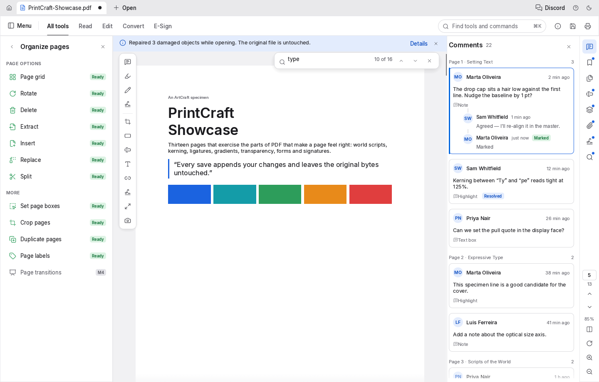
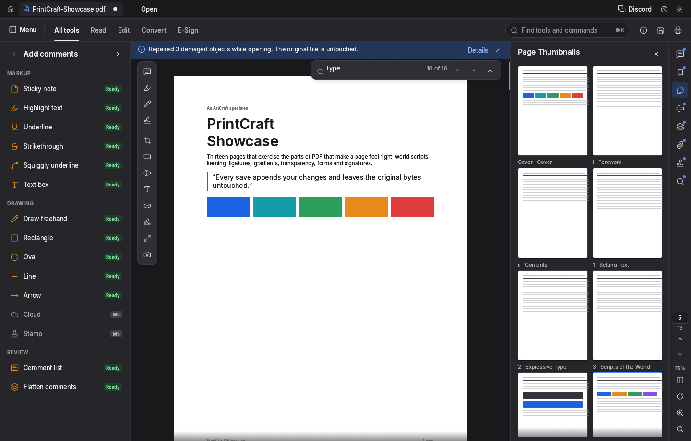

# PrintCraft design demo (Rust)

A minimal, runnable Rust desktop application that reproduces the look and feel of the
[PrintCraft](https://github.com/storytold/printcraft) PDF workbench — the tab strip, mode bar,
tool catalogue, document area, right rail, side panels, Home tab, command palette and dialogs —
on top of the same UI stack PrintCraft uses.

It is a **UI design demo**: every surface is live and interactive, but no PDF engine is linked,
so opening, saving and exporting report through the toast instead. Content is the design's own
specimen (`PrintCraft-Showcase.pdf`, a 13-page document with comments, bookmarks, form fields
and a signature).





## Same dependencies as PrintCraft

| Crate | Version | Use |
| --- | --- | --- |
| `egui` | 0.36 | Immediate-mode widgets and painting |
| `egui_extras` | 0.36 (`svg`) | Lucide SVG rasterization for the icon set |
| `eframe` | 0.36 (`default_fonts`, `wgpu`, `accesskit`, `wayland`, `x11`, `persistence`, `links`) | Window, event loop, GPU renderer, state persistence |
| `serde`, `serde_json` | 1 | Persisted session (theme, mode, panels, zoom) |
| `rfd` | 0.17 | Native Open dialog |
| `log` | 0.4 | Diagnostics |

The renderer backend is wgpu, exactly as in `apps/printcraft/Cargo.toml`.

## Run it

```sh
cargo run            # first build compiles egui/eframe/wgpu, so give it a few minutes
cargo run --release  # smaller, faster
cargo test           # headless smoke test: every mode, panel, overlay and dialog, both themes
```

Requirements: Rust 1.90+ (edition 2024) and a GPU/display supported by wgpu. On Linux the
usual Vulkan/OpenGL drivers are enough.

## What you can do

* Switch workspace modes (`All tools · Read · Edit · Convert · E-Sign`) and toggle the light and
  dark gray themes; both are remembered between runs.
* Browse the full 26-group tool catalogue from the left panel, or search everything with `⌘K`.
* Use the menus (**File / Edit / Pages / View / Help**), the registered commands and their
  shortcuts.
* Work the document: zoom, page navigation by number or by the document's own page label,
  rotate, delete and insert pages in **Organize pages** (with `⌘`/`⇧` multi-select).
* Walk the eight side panels: Comments (reply, resolve), Bookmarks, Page Thumbnails, Form
  Fields, Layers, Attachments, Signatures and Advanced Search — all fed by realistic demo data.
* Find as you type: the find bar and the search panel share the 16 hits for “type”.
* Take the tour from the Home tab: recommended tiles, all tools, recent files.

Everything clickable reports what it did in a toast, so nothing feels inert.

## Documentation

**[docs/UI-COMPONENTS.md](docs/UI-COMPONENTS.md)** documents every UI component — where it
lives in the source, what it looks like, and the functionality it provides (including which
actions are real in this demo and which are engine stubs). Read it alongside:

```
src/
  main.rs            window creation (viewport, app id) — mirrors apps/printcraft/src/main.rs
  lib.rs             modules + headless smoke tests
  app.rs             App state, modes, panels, commands, shortcuts, persistence
  theme.rs           design tokens, fonts, egui style
  icons.rs           embedded Lucide icons, tinting, icon button
  icon_data.rs       generated include_bytes! table for assets/icons/
  data.rs            the catalogue, commands and the specimen document
  widgets.rs         the shared controls (mode tab, pills, fields, chips, toast, …)
  components/
    chrome.rs        tab strip, mode bar, right rail
    panels.rs        left tool panel + all eight right panels
    canvas.rs        notice bar, page stack, quick bar, find bar, Organize grid
    home.rs          Home tab
    palette.rs       ⌘K command palette
    dialogs.rs       Keyboard shortcuts, About, Document Properties, Preferences
docs/UI-COMPONENTS.md
assets/icons/        183 Lucide SVGs (ISC)
assets/fonts/        Inter, JetBrains Mono, Dancing Script (OFL)
```

## Notes

* The reference design lives in the sibling `../desktop-design` folder (HTML/CSS/JS); this crate
  ports it to egui and keeps the class-per-component mapping described in the docs.
* Pages stay white in the dark theme, as PrintCraft does; only the chrome changes.
* Lucide icons are embedded and tinted at runtime — never Unicode glyphs — using the same
  technique as `crates/ui-egui/src/icons.rs`.
* The ArtCraft name and logos are trademarks of the ArtCraft Team and are not used here; the
  demo uses PrintCraft's own icon set and copy only.
